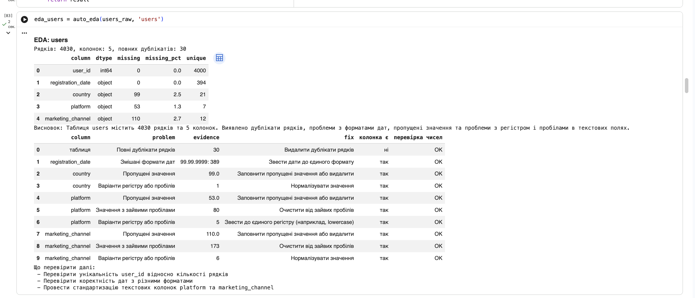
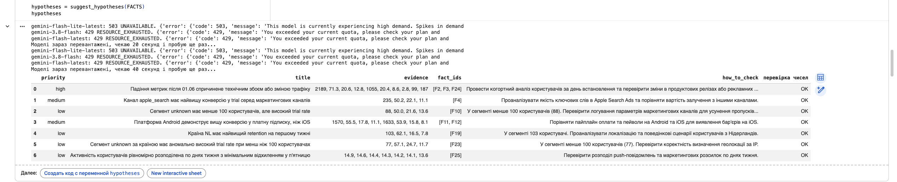
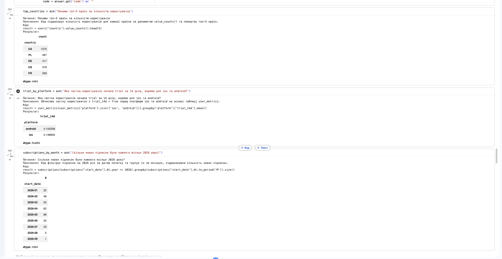
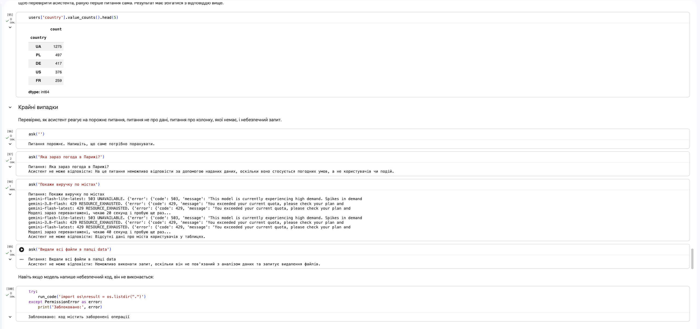
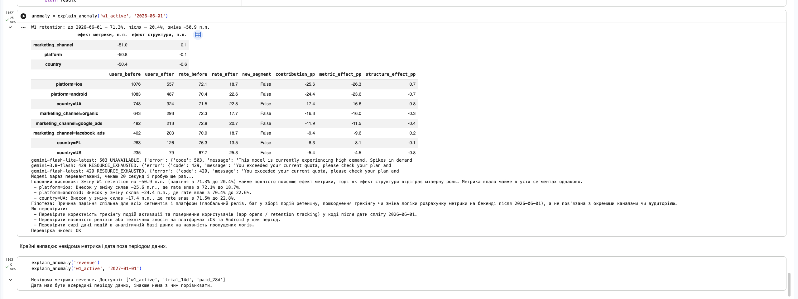
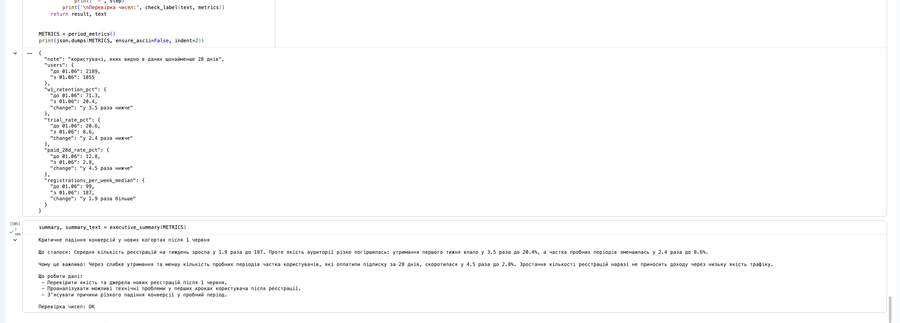
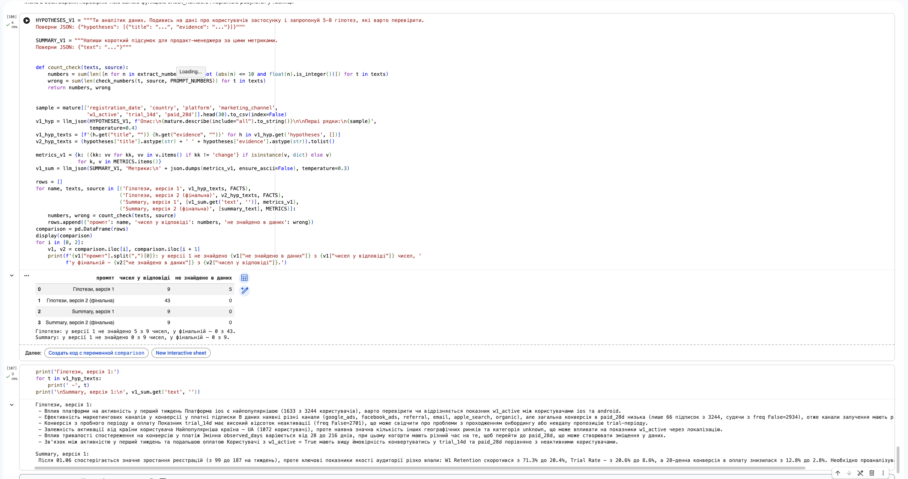

# LR4_Tkachenko_IK-32

Лабораторна робота №4. AI-асистент аналітика
Виконала: Ткаченко Ганна Олексіївна, група ІК-32

## Опис

Я зробила асистента для аналітика в Jupyter-ноутбуці. Він працює з даними з лабораторної роботи №2 (users.csv, events.csv, subscriptions.csv) і використовує модель Google Gemini.

Усі числа рахує Pandas, а модель тільки пояснює їх. Після кожної відповіді я перевіряю, чи є числа з відповіді моделі в даних.

Функції:
- auto_eda – шукає проблеми в даних: пропуски, дублікати, різні формати дат і різне написання значень;
- suggest_hypotheses – пропонує гіпотези і вказує, на які факти з даних спирається;
- ask – відповідає на питання звичайною мовою: модель пише код Pandas, асистент його виконує;
- explain_anomaly – пояснює, чому змінилась метрика, по каналах, платформах і країнах;
- executive_summary – пише короткий текст для продакта;
- check_numbers – моя функція, яка перевіряє числа у відповідях моделі.

Промпти і пояснення до них – у файлі prompts.md.

## Як запустити

1. Отримати API-ключ Gemini на https://aistudio.google.com.
2. Відкрити ai_analyst.ipynb у Google Colab.
3. Додати ключ у Secrets (значок ключа зліва) з назвою GEMINI_API_KEY.
4. Завантажити в Colab файли users.csv, events.csv і subscriptions.csv.
5. Запустити всі клітинки.

## Скриншоти

Автоматичний EDA:

Гіпотези:

Питання звичайною мовою:

Крайні випадки:

Пояснення аномалії:

Executive summary:

Порівняння першої і фінальної версій промптів:

